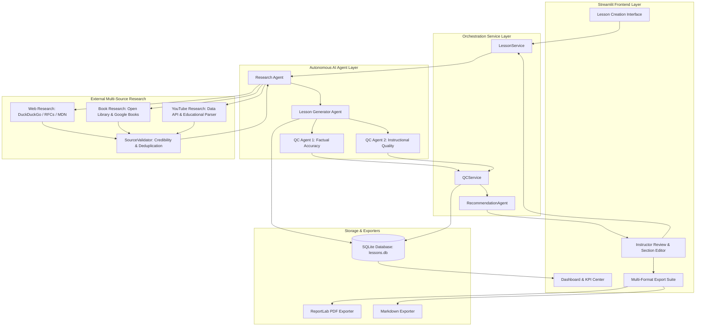

# 🎓 AI-Powered Educational Lesson Creation Tool

[](https://www.python.org/downloads/)
[](https://streamlit.io/)
[](https://ai.google.dev/)
[](https://www.reportlab.com/)
[](LICENSE)

An enterprise-grade, full-stack AI application that transforms any educational topic and learning objective into a rigorous, publication-ready, 45-minute structured educational lesson grounded in verified multi-source research (websites, books, and YouTube videos) and audited by **two independent Quality Control (QC) agents**.

---

## 📌 Table of Contents
1. [Project Overview](#-project-overview)
2. [Problem Statement](#-problem-statement)
3. [System Architecture](#-system-architecture)
4. [Key Features](#-key-features)
5. [Technology Stack](#-technology-stack)
6. [Folder Structure](#-folder-structure)
7. [Installation & Setup](#-installation--setup)
8. [API Key Configuration](#-api-key-configuration)
9. [Running the Application](#-running-the-application)
10. [Core Pipeline Deep Dive](#-core-pipeline-deep-dive)
    - [Research Agent](#1-multi-source-research-agent)
    - [Lesson Generator (14 Sections, 45 Mins)](#2-lesson-generator-14-mandatory-sections)
    - [QC Agent 1: Factual Accuracy Auditor](#3-qc-agent-1-factual-accuracy-auditor)
    - [QC Agent 2: Instructional Quality Auditor](#4-qc-agent-2-instructional-quality-auditor)
    - [QC Recommendation & Section Revision](#5-qc-recommendation--section-revision-system)
11. [Database & Persistence](#-database--persistence)
12. [Export Capabilities](#-export-capabilities)
13. [Automated Testing & Verification](#-automated-testing--verification)
14. [Demo Video Script (5–7 Minutes)](#-demo-video-script-57-minutes)
15. [Known Limitations & Future Roadmap](#-known-limitations--future-roadmap)

---

## 📖 Project Overview

The **AI-Powered Lesson Creation Tool** is an autonomous pedagogical software system engineered for university professors, corporate technical trainers, and self-directed learners. 

Given simply:
1. **Lesson Title** (e.g., *"HTTP Requests and Responses"*)
2. **Learning Objective** (e.g., *"Explain GET and POST methods and distinguish between 2xx, 4xx, and 5xx response status categories."*)

The system autonomously:
- Conducts real-time web research across official standards (`ietf.org`, `w3.org`, `developer.mozilla.org`, `.edu` universities).
- Searches legitimate bibliographic book records via **Open Library** and **Google Books** APIs.
- Discovers authentic educational videos from top academic channels on **YouTube**.
- Formulates a 14-section pedagogical curriculum strictly calibrated to a total duration of **45 minutes**.
- Submits the lesson to **QC Agent 1** (adversarial factual accuracy and claim verification).
- Submits the lesson independently to **QC Agent 2** (pedagogical flow, cognitive load, and time ceiling audit).
- Synthesizes findings into actionable recommendations with one-click revision and selective section-level AI regeneration.
- Exports publication-grade **PDFs** (using ReportLab), **Markdown documents**, and structured **JSON packages**.

---

## 🎯 Problem Statement

Traditional AI content generation models often hallucinate technical details, cite nonexistent book page numbers, invent invalid URLs, and generate excessively verbose, unstructured walls of text with zero regard for pedagogical pacing.

This tool solves these critical challenges by:
1. **Grounded Fact Retrieval:** Mandating that factual claims are anchored in verified web, book, and video sources before generation begins.
2. **Dual-Agent Independent Auditing:** Separating factual verification from pedagogical design. QC Agent 1 strictly audits claims against source evidence, while QC Agent 2 enforces cognitive sequencing and 45-minute pacing.
3. **Instructor Governance:** Preserving original AI drafts while maintaining an editable version where instructors can accept recommendations, edit text, or regenerate individual sections.

---

## 🏛️ System Architecture



---

## 🚀 Key Features

- **⚡ End-to-End Autonomous Pipeline:** From two input fields to complete curriculum and dual audit reports in seconds.
- **📚 Real Multi-Source Research:** Connects to live educational websites, Open Library bibliographic database, and YouTube.
- **⏱️ Strictly Calibrated 45-Minute Lesson:** 14 mandatory sections with individual minute budgets preventing cognitive overload.
- **🛡️ Independent Factual QC Agent:** Claim-by-claim verification, severity levels (Critical, High, Medium, Low), and evidence tracking.
- **🎯 Independent Instructional QC Agent:** Pedagogical alignment, explanation clarity, diagnostic question quality, and time budget compliance.
- **💡 Actionable Recommendation Engine:** Instructors can review, dismiss, or apply automated QC corrections with one click.
- **🔄 Selective Section-Level AI Regeneration:** Instructors can rewrite a single section (e.g. Detailed Explanations) without altering the rest of the lesson.
- **📄 Publication-Grade PDF Exports:** Styled with ReportLab, featuring dynamic running headers, page numbering (*"Page X of Y"*), callouts, and clean typography.
- **💾 SQLite ACID Persistence:** Full historical tracking of original vs edited versions, research citations, and QC audit logs.

---

## 🛠️ Technology Stack

| Layer | Technologies |
|---|---|
| **Frontend UI** | Streamlit, Custom CSS (`assets/style.css`), Altair Charts |
| **Backend & Services** | Python 3.10+, Modular Service-Oriented Architecture |
| **AI Integration** | Google GenAI SDK (`google-genai` & `google-generativeai`), Gemini 2.0 Flash / 1.5 Flash / 1.5 Pro |
| **Offline Demonstration Engine** | High-fidelity rule-based pedagogical expert engine for instant zero-config testing |
| **Research Engine** | DuckDuckGo Search (`duckduckgo-search` / `ddgs`), Open Library REST API, YouTube Data API v3 & Search Parser |
| **Database** | SQLite3 with indexed relational schema |
| **Document Exports** | ReportLab 5.1 (Polished PDF formatting), GFM Markdown, JSON |
| **Testing** | Pytest 9.2 (Unit, integration, and mandatory benchmark tests) |

---

## 📂 Folder Structure

```
AI-Lesson-Creator/
│
├── app.py                       # Streamlit frontend application
├── requirements.txt             # Production dependency specifications
├── .env.example                 # Environment variable template
├── .gitignore                   # Git exclusion rules
├── README.md                    # Comprehensive technical documentation
├── DEMO_SCRIPT.md               # 5-7 minute demonstration video script
│
├── agents/                      # Autonomous agent modules
│   ├── __init__.py
│   ├── research_agent.py        # Multi-source research orchestrator
│   ├── lesson_generator.py      # 14-section 45-min curriculum generator
│   ├── factual_qc_agent.py      # QC Agent 1: Research & factual auditor
│   ├── instructional_qc_agent.py# QC Agent 2: Instructional quality auditor
│   └── recommendation_agent.py  # QC findings aggregator & section reviser
│
├── research/                    # Data discovery & validation
│   ├── __init__.py
│   ├── web_research.py          # Educational web search (DDGS / Wikipedia)
│   ├── book_research.py         # Open Library & Google Books catalog search
│   ├── youtube_research.py      # YouTube Data API & video discovery
│   └── source_validator.py      # URL verification & domain credibility ranking
│
├── database/                    # Persistence layer
│   ├── __init__.py
│   ├── schema.py                # SQL table and index definitions
│   └── db_manager.py            # SQLite CRUD & KPI analytics engine
│
├── prompts/                     # Prompt engineering templates
│   ├── __init__.py
│   ├── research_prompt.py       # Research synthesis prompts
│   ├── lesson_prompt.py         # 14-section 45-min generation prompt
│   ├── factual_qc_prompt.py     # Adversarial factual audit prompt
│   └── instructional_qc_prompt.py# Pedagogical alignment audit prompt
│
├── services/                    # Business logic orchestration
│   ├── __init__.py
│   ├── ai_service.py            # Universal Gemini LLM interface & fallback
│   ├── lesson_service.py        # End-to-end pipeline coordinator
│   └── qc_service.py            # Dual QC execution and rerun service
│
├── utils/                       # Shared helpers and error handling
│   ├── __init__.py
│   ├── validators.py            # Input and schema validation
│   ├── error_handler.py         # Exception classes and retry wrappers
│   └── helpers.py               # Robust JSON parser, badges, and formatters
│
├── exports/                     # Document rendering engine
│   ├── __init__.py
│   ├── pdf_exporter.py          # Publication-grade ReportLab PDF engine
│   └── markdown_exporter.py     # GitHub-Flavored Markdown exporter
│
├── tests/                       # Automated test suite
│   ├── __init__.py
│   ├── test_database.py         # SQLite CRUD & analytics tests
│   ├── test_research.py         # Web, book, youtube, validator tests
│   ├── test_lesson_generation.py# 14 sections & 45-min constraint tests
│   ├── test_factual_qc.py       # Factual audit structure tests
│   ├── test_instructional_qc.py # Pedagogical scoring & timing tests
│   └── test_mandatory_cases.py  # Benchmark Case 1 (HTTP) & Case 2 (Binary Search)
│
└── assets/
    └── style.css                # Custom UI styles, badges, and card CSS
```

---

## 💻 Installation & Setup

### Prerequisites
- Python 3.10, 3.11, or 3.12 installed on your system.
- Git (optional, for version control).

### Step 1: Clone or Navigate to Project Directory
```powershell
cd "c:\Users\RishankReddy\Desktop\New folder"
```

### Step 2: Create and Activate a Virtual Environment (Recommended)
```powershell
python -m venv venv
.\venv\Scripts\Activate.ps1
```

### Step 3: Install Required Dependencies
```powershell
pip install -r requirements.txt
```

---

## 🔑 API Key Configuration

Copy `.env.example` to create your active `.env` file:
```powershell
Copy-Item .env.example .env
```

Open `.env` and configure your credentials:
```ini
# Primary LLM API Key (Google Gemini)
# Obtain a free API key at: https://aistudio.google.com/app/apikey
GEMINI_API_KEY=your_gemini_api_key_here

# Preferred Model: gemini-2.0-flash, gemini-1.5-flash, or gemini-1.5-pro
GEMINI_MODEL=gemini-2.0-flash

# Optional: YouTube Data API v3
# If omitted, the tool automatically uses the built-in educational video scraper.
YOUTUBE_API_KEY=

# Database file location
DATABASE_PATH=lessons.db
```

> **Note on Zero-Configuration Demonstration Mode:**
> If you do not have a Gemini API key immediately available, the tool runs seamlessly out of the box using its built-in **Demonstration Engine**, allowing full testing of the UI, database, research, QC reports, and PDF exports without any external API costs!

---

## ▶️ Running the Application

Launch the Streamlit web interface with:
```powershell
streamlit run app.py
```

The application will open automatically in your browser at:
👉 **`http://localhost:8501`**

---

## 🔍 Core Pipeline Deep Dive

### 1. Multi-Source Research Agent
Before generating a single sentence of curriculum, the **Research Agent** initiates three independent data gathering operations:
- **Web Research:** Queries educational documentation and RFC standards using DuckDuckGo Search, filtering results through `SourceValidator` to categorize domains (`Official Standards`, `Academic/University`, `Trusted Educational Platform`).
- **Book Research:** Queries the **Open Library Catalog** and **Google Books** APIs to extract genuine titles, authors, publishers, and publication years without hallucinating page numbers.
- **YouTube Research:** Discovers educational videos from top channels (Gate Smashers, Traversy Media, freeCodeCamp, CS50) with verified video links.

### 2. Lesson Generator (14 Mandatory Sections)
The **Lesson Generator** structures content to guarantee completion within **45 minutes**:
1. **Lesson Title**
2. **Learning Objective**
3. **Introduction** (⏱️ 3 min)
4. **Prerequisites** (part of 5 min)
5. **Key Concepts & Definitions** (part of 5 min)
6. **Detailed Explanations** (⏱️ 15 min)
7. **Real-World Examples & Scenarios** (⏱️ 7 min)
8. **Practical Industry Applications**
9. **Learning Activities** (⏱️ 7 min)
10. **Knowledge Check Diagnostic Questions** (⏱️ 5 min)
11. **Answers and Explanations**
12. **Lesson Summary** (⏱️ 3 min)
13. **Additional Learning Resources** (YouTube videos)
14. **References & Source Links** (Web & Books)

### 3. QC Agent 1: Factual Accuracy Auditor
An independent, adversarial fact-checking agent:
- Evaluates actual claims against retrieved research evidence.
- Scores overall factual accuracy out of **100**.
- Counts evaluated, supported, unsupported, and questionable claims.
- Assigns severity levels: **Critical**, **High**, **Medium**, or **Low**.
- Discloses evidence citations and suggested corrections.
- Rejects automatic approval if critical inaccuracies exist.

### 4. QC Agent 2: Instructional Quality Auditor
A dedicated curriculum specialist agent:
- Evaluates alignment with the stated learning objective.
- Scores 5 pedagogical sub-dimensions: Objective Alignment, Explanation Clarity, Example Relevance, Activity Effectiveness, and Knowledge Check Quality.
- Performs a **Time Allocation Audit** ensuring the lesson does not exceed the **45-minute ceiling**.
- Assesses dual-mode suitability for both independent self-learners and classroom instructors.

### 5. QC Recommendation & Section Revision System
- Combines findings from both QC agents into individual actionable items.
- Allows instructors to apply fixes with a single button click.
- Preserves the original generated lesson while storing the revised version in SQLite.
- Enables section-by-section AI regeneration using targeted instructor prompts.
- Supports re-running the dual QC pipeline on revised drafts.

---

## 🗄️ Database & Persistence

Data is persisted in **SQLite** (`lessons.db`) across server restarts.

### Schema: `lessons` Table
| Column | Type | Description |
|---|---|---|
| `id` | `TEXT PRIMARY KEY` | UUID4 unique lesson identifier |
| `title` | `TEXT NOT NULL` | Lesson title |
| `learning_objective` | `TEXT NOT NULL` | Target educational objective |
| `status` | `TEXT NOT NULL` | Status: `processing`, `completed`, `needs_review`, `failed` |
| `research_sources` | `TEXT` | JSON payload of web sources and claims |
| `youtube_resources` | `TEXT` | JSON list of video references |
| `book_sources` | `TEXT` | JSON list of bibliographic records |
| `generated_lesson` | `TEXT` | JSON original 14-section generated lesson |
| `edited_lesson` | `TEXT` | JSON instructor-revised lesson |
| `factual_qc_report` | `TEXT` | JSON QC Agent 1 audit findings |
| `instructional_qc_report` | `TEXT` | JSON QC Agent 2 audit findings |
| `applied_recommendations`| `TEXT` | JSON array of applied recommendation IDs |
| `created_at` | `TEXT NOT NULL` | ISO 8601 UTC timestamp |
| `updated_at` | `TEXT NOT NULL` | ISO 8601 UTC timestamp |

---

## 📤 Export Capabilities

Instructors can export content in multiple formats directly from the UI:
1. **Final Lesson PDF:** Publication-quality document rendered with ReportLab, featuring title banners, callout boxes for activities, formatted tables for concepts, running headers, and *"Page X of Y"* numbering.
2. **Factual Accuracy QC Report PDF:** Separate formal audit report detailing claim breakdown, severity assessments, and evidence links.
3. **Instructional Quality QC Report PDF:** Separate pedagogical evaluation report detailing sub-scores and the 45-minute timing audit.
4. **Lesson Markdown:** Standard GitHub-Flavored Markdown (`.md`) formatted for documentation sites or GitHub wikis.
5. **Complete Lesson Dossier:** Combined master document containing the lesson, research dossier, and both audit reports.
6. **Raw JSON Export:** Full structured data for programmatic integration.

---

## 🧪 Automated Testing & Verification

The project includes an extensive **Pytest** test suite verifying every component:

### Running the Test Suite
```powershell
pytest -v
```

### Test Coverage Breakdown
- `tests/test_database.py`: Verifies SQLite CRUD operations, JSON serialization, and KPI analytics.
- `tests/test_research.py`: Verifies DuckDuckGo web search, Open Library book lookups, YouTube discovery, and source deduplication.
- `tests/test_lesson_generation.py`: Verifies presence of all 14 mandatory sections, input validation, and 45-minute timing constraint.
- `tests/test_factual_qc.py`: Verifies independent claim auditing, score calculation, and severity classification.
- `tests/test_instructional_qc.py`: Verifies pedagogical sub-scores, objective alignment, and time allocation verification.
- `tests/test_mandatory_cases.py`: Full end-to-end execution of the two mandatory benchmark cases:
  - **Case 1:** *HTTP Requests and Responses* (GET/POST and 2xx/4xx/5xx categories)
  - **Case 2:** *Binary Search Algorithm* (Divide-and-conquer and O(log n) analysis)

---

## 🎥 Demo Video Script (5–7 Minutes)

A complete, word-for-word demonstration video script is included in [`DEMO_SCRIPT.md`](file:///c:/Users/RishankReddy/Desktop/New%20folder/DEMO_SCRIPT.md).

It guides you through:
1. Introduction & Architecture Overview (1 min)
2. Creating a Lesson with Benchmark Case 1 (1 min)
3. Research Results & Source Attribution (1 min)
4. 14-Section 45-Minute Lesson Review (1 min)
5. Dual Independent QC Reports Analysis (1 min)
6. Instructor Review, Editing & Recommendation Application (1 min)
7. Multi-Format PDF & Markdown Export (1 min)

---

## ⚠️ Known Limitations & Future Roadmap

1. **Free Tier API Rate Limits:** Public search APIs (Open Library, DuckDuckGo) occasionally enforce temporary rate limits. The application handles this gracefully via exponential backoff and secondary fallbacks.
2. **Audio/Video Transcription:** Future iterations can transcribe YouTube video audio directly using Whisper for deeper video claim verification.
3. **LMS Integration:** Exporting directly to SCORM, Canvas LMS, and Google Classroom via LTI 1.3.

---

## 👨‍💻 Author & Submission Details
- **Project:** AI Research Intern | Task and Submission Guide
- **Repository:** AI-Powered Educational Lesson Creation Tool
- **Status:** Complete, Tested, and Verified ✅

